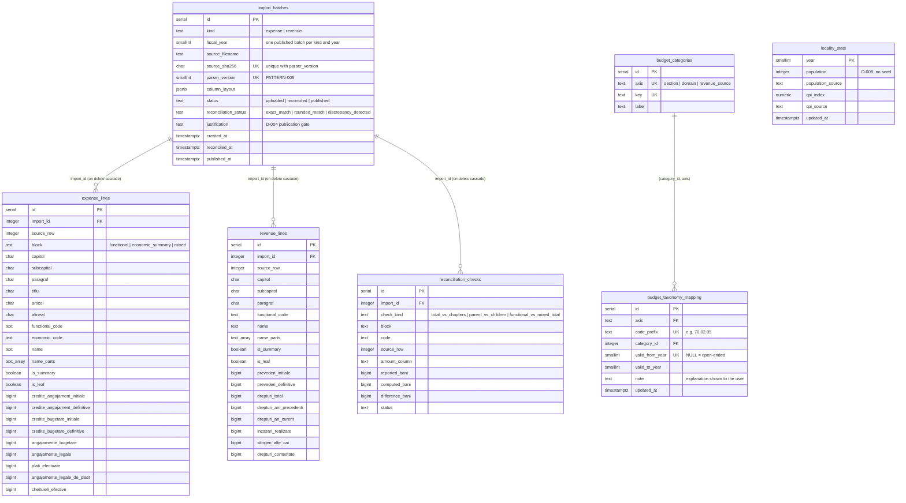

# Architecture — proiect_web1

<!-- graffino-agentic:begin v1 -->
> How this repo is built, generated from the code at backfill and kept current by
> whoever changes the structure. The code wins: when this page is wrong, fix it.
<!-- graffino-agentic:end -->

## Overview
P09, local budget explorer for Comuna Șura Mare. Current state (Step E): the data
foundation. Budget execution files are parsed, reconciled and stored in PostgreSQL. There
is no web UI yet: Next.js comes in the next plan (D-002).

```text
data/raw/*.xlsx ──► parseBudgetFile ──► reconcile ──► importBudgetFile ──► PostgreSQL 16
 (or UTF-8 CSV)     (layout, rules 1-7)  (D-004)       (status reconciled)   (Docker)
```

## Parts
| Part | Path | Responsibility | Talks to |
|---|---|---|---|
| Money | `src/lib/money.ts` | amount cells (whole lei) → bani `bigint` (D-007) | — |
| Layout | `src/lib/budget/layout.ts` | column positions passed to the parser, validated; default layouts | — |
| Parser | `src/lib/budget/parse.ts` | DATA.md §4.2 rules 1–7 → logical lines with blocks, codes, summary/leaf flags | SheetJS |
| Reconciliation | `src/lib/budget/reconcile.ts` | total vs chapters, parent vs children, functional vs economic total; D-004 statuses; `canPublish` | — |
| Schema | `src/db/schema.ts`, `drizzle/` | 7 tables and their constraints | PostgreSQL |
| Import | `src/db/import.ts`, `scripts/import-raw.ts` | parse + reconcile + store in one transaction; a file already stored with the same sha256 and `PARSER_VERSION` is reported as `already_imported` (`ON CONFLICT DO NOTHING`); a newer parser version re-parses it into a new batch and keeps the old one (PATTERN-005) | PostgreSQL |
| Repository docs & ledger | `docs/agents/` | rules, decisions, architecture | agent / developer |
| Agentic workflows | `.claude/`, `.agents/` | planning and building automations | agent CLI / IDE |

## Data flow
1. `npm run db:import` reads each `data/raw/{cheltuieli,venituri}<year>.xlsx`.
2. `parseBudgetFile(bytes, format, layout)` returns logical lines; any malformed cell
   stops the file with its row and column.
3. `reconcile(parsed)` returns every check and the worst status.
4. `importBudgetFile` stores the batch (with the layout used), the lines and the checks
   in one transaction, with status `reconciled`. Publishing is a later admin action,
   guarded by `canPublish` and by the `import_batches_publication_gate_check` constraint.

## State and storage
| What | Where | Owner | Notes |
|---|---|---|---|
| Imported files | `import_batches` | import | kind, year, filename, sha256 + `parser_version` (unique together), layout (jsonb), lifecycle status; at most one `published` batch per kind and year (partial unique index) |
| Expense lines | `expense_lines` | import | 3 blocks (functional, economic_summary, mixed); 9 BIGINT amounts in bani; `name_parts` keeps the raw name fragments |
| Revenue lines | `revenue_lines` | import | 8 BIGINT amounts in bani; `name_parts` keeps the raw name fragments |
| Reconciliation checks | `reconciliation_checks` | import | one row per check and amount column |
| Population and CPI | `locality_stats` | user (D-008) | empty until INS data is entered |
| Taxonomy | `budget_categories`, `budget_taxonomy_mapping` | admin (D-009) | structure only; year-dependent, with notes |
| Database data | Docker volume `pgdata` | Docker | `budget` (dev) and `budget_test` (integration tests) |
| Knowledge ledger | `docs/agents/` | Git | maintained via `ledger-lint.py` |

### Entity relationships
Generated from `src/db/schema.ts` (migrations `drizzle/0000`–`0002`). Money columns are
`BIGINT` in bani (D-007). `expense_lines` and `revenue_lines` have no foreign key to the
taxonomy tables: lines are matched to `budget_taxonomy_mapping` by code prefix and year
at query time (D-009). `locality_stats` is joined by year, with no foreign key.



## Configuration
| Name | Where set | Used by | Notes |
|---|---|---|---|
| `POSTGRES_USER`, `POSTGRES_PASSWORD`, `POSTGRES_DB` | `.env` | docker compose | `.env` is git-ignored; template in `.env.example` |
| `DATABASE_URL` | `.env` | drizzle-kit, `db:import` | dev database |
| `TEST_DATABASE_URL` | `.env`, CI env | `test:db` | must end in `_test` |

## Build, deploy, runtime
Runs locally: Node ≥ 24 (CI uses 26) and Docker. CI on GitHub Actions
(`.github/workflows/ci.yml`) runs typecheck, unit tests, integration tests against a
PostgreSQL 16 service container, and the ledger lint. No deployment yet.

## Boundaries
Local development boundary. Secrets are never committed (`.env` is git-ignored). The
integration tests only touch a `*_test` database and roll back every test.
PostgreSQL is published on `127.0.0.1:5432` only.

Required before the upload and publication routes exist (deferred from the PR #1 review):
- Upload: input limits for the parser (file size, sheet range, rows, ZIP signature), see Q-008.
- Publication: the route never accepts `reconciliation_status` from the client, see Q-009.
